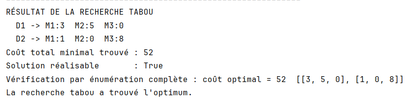
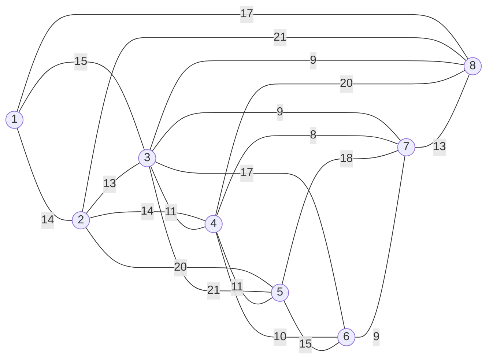
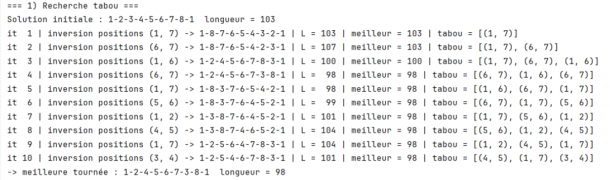
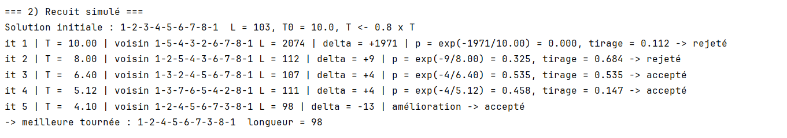
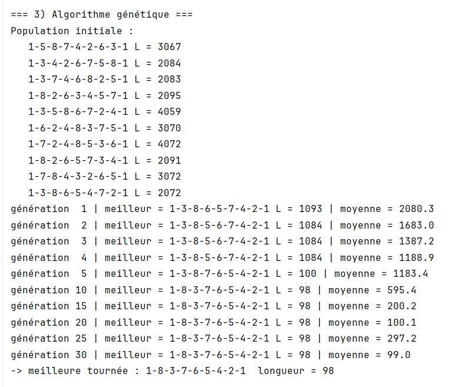

# Modélisation des problèmes 

Ce fichier contient uniquement la modélisation des deux problèmes :

1. Exercice 2 : livraison de containers (problème de transport)
2. Exercice 3 : voyageur de commerce (TSP) à 8 villes

---

## Exercice 2 : livraison de containers

### Données

| Coût d'un container | M1 | M2 | M3 | Stock du dépôt |
|---|---|---|---|---|
| **D1** | 5 | 3 | 4 | 8 |
| **D2** | 6 | 7 | 2 | 9 |
| **Demande du magasin** | 4 | 5 | 8 | 17 = 17 |

- Dépôts : D1, D2 (indice `d` = 1, 2)
- Magasins : M1, M2, M3 (indice `m` = 1, 2, 3)
- `c[d][m]` : coût de transport d'un container du dépôt `d` vers le magasin `m`
- `stock[d]` : nombre de containers disponibles au dépôt `d`
- `demande[m]` : nombre de containers commandés par le magasin `m`

Le stock total (8 + 9 = 17) est égal à la demande totale (4 + 5 + 8 = 17) : tout le stock part et toute la demande est servie.

### Variables de décision

```
x[d][m] = nombre de containers envoyés du dépôt d vers le magasin m
x[d][m] entier, x[d][m] >= 0
```

Une solution est donc une matrice 2 x 3 de nombres entiers.

### Fonction objectif

Minimiser le coût total de transport :

```
min  Z = 5*x11 + 3*x12 + 4*x13 + 6*x21 + 7*x22 + 2*x23
```

soit, en général : `min Z = somme sur d et m de c[d][m] * x[d][m]`.

### Contraintes

```
Chaque dépôt vide son stock :
    x11 + x12 + x13 = 8        (D1)
    x21 + x22 + x23 = 9        (D2)

Chaque magasin reçoit sa demande :
    x11 + x21 = 4              (M1)
    x12 + x22 = 5              (M2)
    x13 + x23 = 8              (M3)

Entiers et positifs :
    x[d][m] entier >= 0
```

### Modèle complet (programmation linéaire en nombres entiers)

```
min   somme_d somme_m  c[d][m] * x[d][m]

sous contraintes
    somme_m x[d][m] = stock[d]       pour chaque dépôt d
    somme_d x[d][m] = demande[m]     pour chaque magasin m
    x[d][m] entier >= 0
```

### Exemple de solution réalisable

```
          M1  M2  M3
    D1     4   4   0     somme = 8  (stock de D1)
    D2     0   1   8     somme = 9  (stock de D2)
 somme     4   5   8     = demandes
```

Coût : `4*5 + 4*3 + 0*4 + 0*6 + 1*7 + 8*2 = 55`.

---

## Exercice 3 : voyageur de commerce (TSP)

### Données

Distances entre les villes (un tiret signifie qu'il n'existe pas de route directe) :

| Ville | 2 | 3 | 4 | 5 | 6 | 7 | 8 |
|---|---|---|---|---|---|---|---|
| **1** | 14 | 15 | - | - | - | - | 17 |
| **2** | | 13 | 14 | 20 | - | - | 21 |
| **3** | | | 11 | 21 | 17 | 9 | 9 |
| **4** | | | | 11 | 10 | 8 | 20 |
| **5** | | | | | 15 | 18 | - |
| **6** | | | | | | 9 | - |
| **7** | | | | | | | 13 |

### Modélisation par un graphe

Le problème est un graphe pondéré non orienté `G = (V, E)` :

- **Sommets** `V = {1, 2, 3, 4, 5, 6, 7, 8}` : les villes
- **Arêtes** `E` : les routes qui existent (20 arêtes)
- **Poids** `d(i, j)` : la distance de la route entre les villes `i` et `j`



Le graphe n'est **pas complet** : il y a 28 paires de villes possibles et seulement 20 routes. Les 8 routes absentes sont :
`1-4`, `1-5`, `1-6`, `1-7`, `2-6`, `2-7`, `5-8`, `6-8`.

### Formulation équivalente

Chercher dans `G` un **cycle hamiltonien de poids minimal** : un cycle qui passe exactement une fois par chaque sommet et dont la somme des poids des arêtes est la plus petite possible.

### Modèle mathématique

Variables de décision (une par arête `{i, j}` avec `i < j`) :

```
x[i][j] = 1 si la route entre les villes i et j est utilisée dans la tournée
x[i][j] = 0 sinon
```

Fonction objectif (longueur totale de la tournée) :

```
min  Z = somme sur les arêtes {i, j} de  d(i, j) * x[i][j]
```

Contraintes :

```
Chaque ville a exactement 2 routes utilisées (une pour arriver, une pour repartir) :
    somme_j x[i][j] = 2                              pour chaque ville i

Pas de petit cycle isolé (élimination des sous-tours) :
    somme des x[i][j] avec i et j dans S  <=  |S| - 1
    pour tout sous-ensemble S de villes, 2 <= |S| <= 7

Variables binaires :
    x[i][j] dans {0, 1}
```

La première famille de contraintes impose que chaque ville soit reliée à deux autres. La deuxième empêche d'obtenir plusieurs petits cycles séparés (par exemple 1-2-3-1 et 4-5-6-7-8-4) au lieu d'une seule tournée complète.

### Représentation utilisée pour les méthodes approchées (tabou, recuit, génétique)

Au lieu des variables `x[i][j]`, on représente une solution par une **permutation des villes** :

```
tournée = (v1, v2, ..., v8)      par exemple (1, 2, 3, 4, 5, 6, 7, 8)
```

La tournée est fermée : après `v8` on retourne à `v1`. La ville 1 reste toujours en première position (cela évite de compter la même tournée plusieurs fois, et laisse 7! = 5040 tournées possibles).

Longueur d'une tournée :

```
L(tournée) = d(v1, v2) + d(v2, v3) + ... + d(v7, v8) + d(v8, v1)
```

**Routes absentes.** Pour que cette formule marche partout, on complète le graphe : chaque route absente reçoit une distance très grande (1000). Une tournée qui l'utilise devient énorme et est rejetée naturellement par les algorithmes.

Exemple, tournée de départ `1-2-3-4-5-6-7-8-1` :

```
L = d(1,2) + d(2,3) + d(3,4) + d(4,5) + d(5,6) + d(6,7) + d(7,8) + d(8,1)
  =  14    +  13    +  11    +  11    +  15    +  9     +  13    +  17
  = 103
```

Toutes ces routes existent : la tournée est valide, de longueur 103.


